# Meme Studio

> Your Personal Meme Asset Factory — **Discover · Create · Collect · Share**
>
> Cut out heads, build real alpha-outline stickers, compose memes on an infinite canvas and batch-process entire folders — **all inside your browser, with no API key and no uploads**.

**Live demo:** <https://iiiiiiiiiiiiiKK.github.io/meme-studio/> · **Author:** [@0xkillcoin](https://x.com/0xkillcoin)

## English

Meme Studio is a **local-first** meme asset factory that runs entirely in the browser tab:

- **Local AI cutouts** — FaceMesh locates the person, MediaPipe Selfie Segmentation produces the real silhouette, and the head region is derived from the *actual alpha channel* rather than a bounding box.
- **True sticker outlines** — white / black / coloured, single or double, plus shadow and glow. The stroke is computed with a real distance transform on the alpha mask, so it follows hair, ears and fingers.
- **Infinite canvas editor** — layers (image / text / shape), move, resize, rotate, opacity, layer ordering, undo/redo, autosave and PNG / JPEG / WebP export at 1×–3×.
- **Batch Studio** — queue dozens of photos, apply one preset, pause / resume / retry, export everything as a single ZIP. A single failure never kills the batch.
- **My Space** — a local asset library (IndexedDB) with folders, tags, favourites, trash and restore.
- **Templates** — parameter presets for outlines, extraction modes, canvas sizes, export settings and batch runs.
- **Bilingual UI** — the whole interface is available in English and 简体中文, with a switch in Settings; the language is detected from the browser on first visit and remembered afterwards.

| Home | Create |
| --- | --- |
| 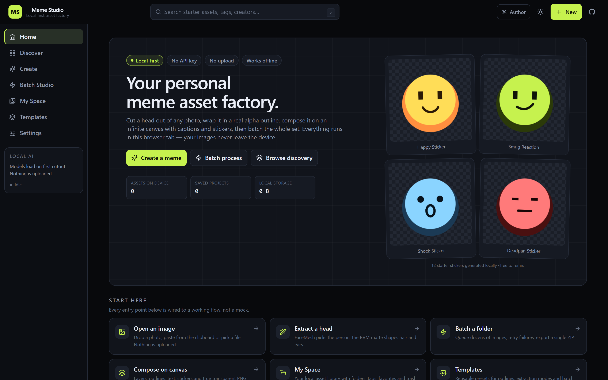 | 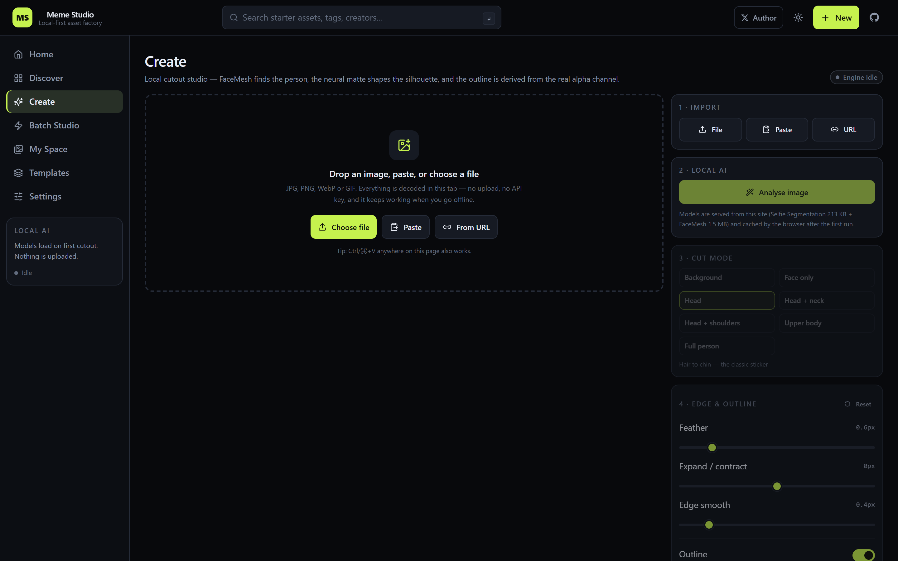 |

| Editor | Batch Studio |
| --- | --- |
| 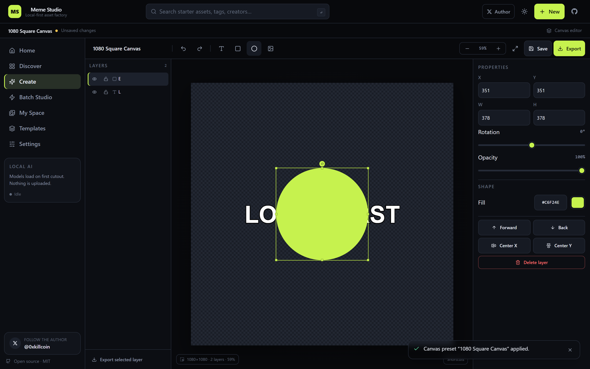 | 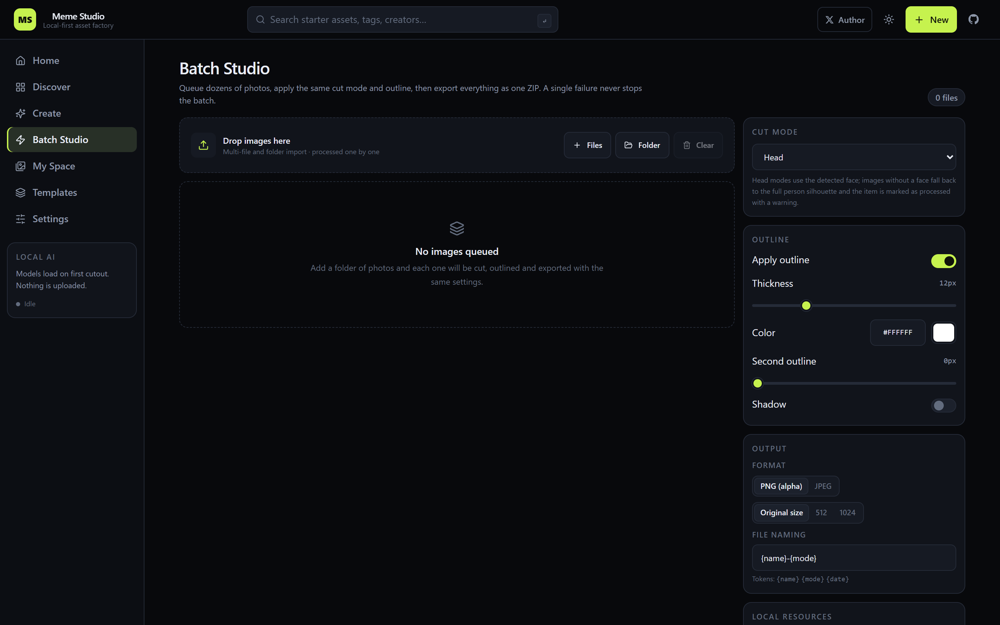 |

| Discover | Templates |
| --- | --- |
| 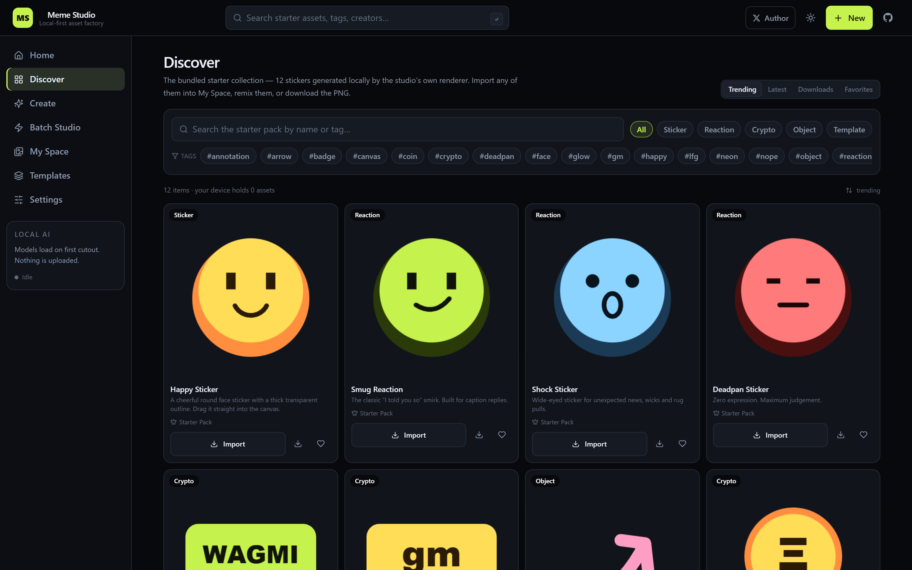 | 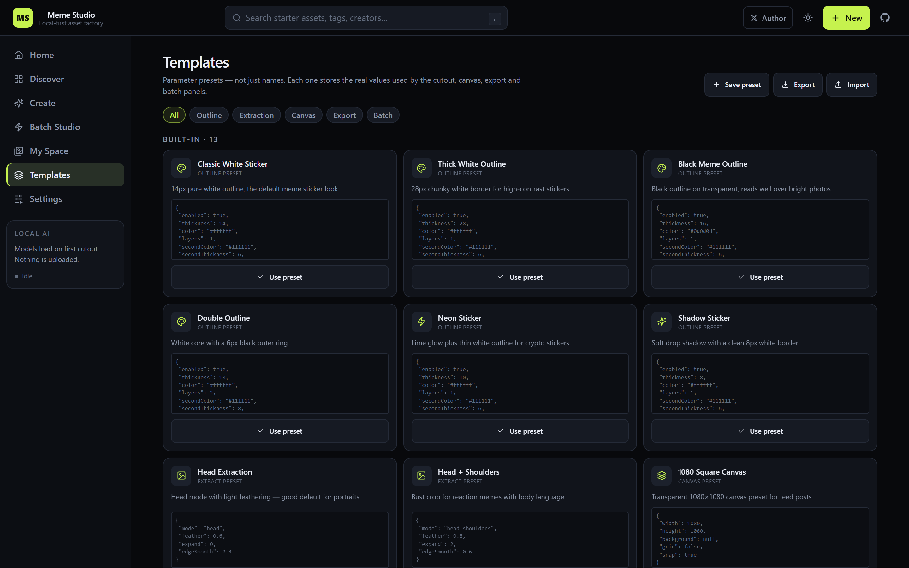 |

<p align="center">
  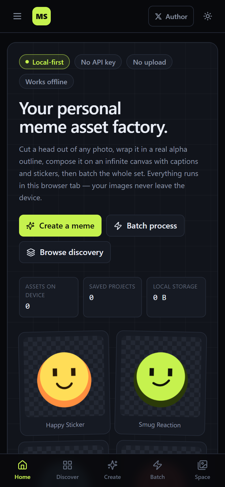
  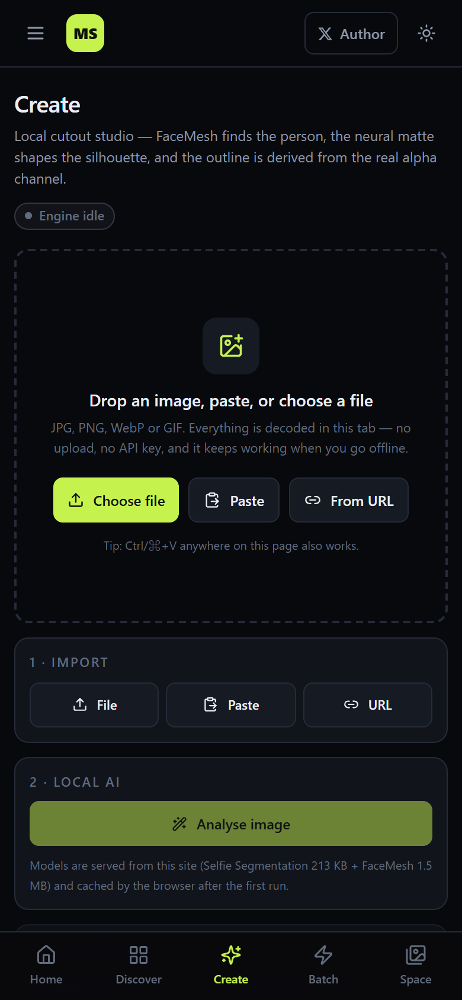
  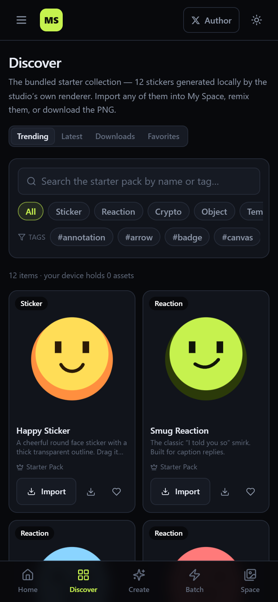
</p>

### Quick start

```bash
git clone https://github.com/iiiiiiiiiiiiiKK/meme-studio.git
cd meme-studio
npm install
npm run dev          # http://127.0.0.1:5199
```

Requirements: **Node.js 18+** and a browser with WebGL (Chrome, Edge, Firefox, Safari 16+). Without WebGL the engine
falls back to the WASM backend; without either, the clearly-labelled colour matte is used.

### Scripts

| Command | What it does |
| --- | --- |
| `npm run dev` | Vite dev server |
| `npm run build` | Type-check and produce the production bundle in `dist/` |
| `npm run preview` | Serve the production bundle locally |
| `npm test` | Vitest unit suite (44 tests) |
| `npm run e2e` | Playwright suite (23 tests: desktop Chromium + mobile WebKit) |
| `npm run screenshots` | Regenerate the images in `docs/screenshots` |

### Environment variables

**There are none.** Meme Studio has no backend, no database server and no third-party service, so there is nothing to
configure and no secret to leak.

### How the cutout actually works

1. **Selfie Segmentation** produces a person matte, bilinearly upsampled to the source resolution.
2. **BlazeFace + FaceMesh** detect the faces and give the 468-point landmark mesh.
3. A **head region** is built from the 36-point FaceMesh contour (plus a hair dome and a neck/shoulder band) — it only decides *which part* of the silhouette survives.
4. The region is **intersected with the real person alpha**, so hair, ears and shoulders are shaped by the model, never
   by a rectangle.
5. Feather / expand / edge-smooth are real mask operations (separable box blur, chamfer distance transform).
6. Only the **connected component that owns the selected face** is kept, so other people in a group photo never leak
   into the sticker.
7. The **outline** is generated by dilating the alpha mask; the subject is painted on top, so the stroke never eats
   into the person.

The **Mask** tab adds an erase/restore brush so you can pull back a stray shoulder or bring back hair without
touching the original file.

### Deployment

A pure static app — no server, no environment variables, no database.

```bash
npm run build     # publish the ./dist folder with any static host
```

GitHub Pages is used by this project (`.github/workflows/deploy.yml`); the live URL is
**<https://iiiiiiiiiiiiiKK.github.io/meme-studio/>**. See [docs/DEPLOYMENT.md](docs/DEPLOYMENT.md).

### Security & privacy

- **No image ever leaves the device.** No upload endpoint, no API key, no third-party script.
- The only outbound requests are the app bundle and the model files served by the same host.
- No analytics, no tracking pixel, no third-party font.
- “Import from URL” fetches directly from your browser — that site sees your IP, exactly as opening it in a tab would.
- Local data lives in IndexedDB for the current browser profile; there is no cloud backup.

### Known limitations

- **Discover is the bundled starter pack**, not a hosted multi-user gallery. A real community backend is on the
  roadmap but is *not* in this release — the UI says so instead of showing mock data.
- **Head extraction quality depends on the source photo.** Strong backlight, hats, motion blur or a face smaller than
  ~40 px reduce quality; the Mask tab exists for that reason.
- **WebGL is strongly recommended** — the WASM fallback is noticeably slower on large images.
- **No cloud sync** and **no i18n** in this release.

### Documentation

- [Architecture](docs/ARCHITECTURE.md) · [Deployment](docs/DEPLOYMENT.md) · [Test report](docs/TEST-REPORT.md) ·
  [Troubleshooting](docs/TROUBLESHOOTING.md) · [Contributing](CONTRIBUTING.md)

### Licence

[MIT](LICENSE) © Meme Studio contributors · Author [@0xkillcoin](https://x.com/0xkillcoin)

---

## 中文

**MEME STUDIO** 是一个完全运行在浏览器里的「本地优先」Meme 素材工厂：

- **本地 AI 抠图** —— FaceMesh 定位人物，人物分割模型生成真实轮廓，头部区域由 **36 点脸部轮廓 + 头发穹顶**推导，而不是套一个矩形框；只保留选中人物所在的连通区域，群像里其他人物不会混进来。
- **真正的贴纸描边** —— 白 / 黑 / 彩色描边，单层或双层，可加阴影与发光；描边基于 Alpha 蒙版的距离变换生成，贴合头发与耳朵。
- **无限画布编辑器** —— 图层（图片 / 文字 / 形状）、移动缩放旋转、图层排序、撤销重做、自动保存，PNG / JPEG / WebP 1×–3× 导出。
- **批量工作室** —— 一次导入几十张图片，统一套用预设，暂停 / 继续 / 重试，打包导出 ZIP；单张失败不中断整个批次。
- **My Space（个人空间）** —— 基于 IndexedDB 的本地素材库，支持分类、标签、收藏、回收站与恢复。
- **模板中心** —— 描边、提取模式、画布尺寸、导出与批量参数的**真实预设**。
- **中英双语界面** —— 全站文案支持简体中文与英文，可在设置中切换；首次访问会自动跟随浏览器语言，之后记住选择。

| 首页 | 创作（抠图台） |
| --- | --- |
| 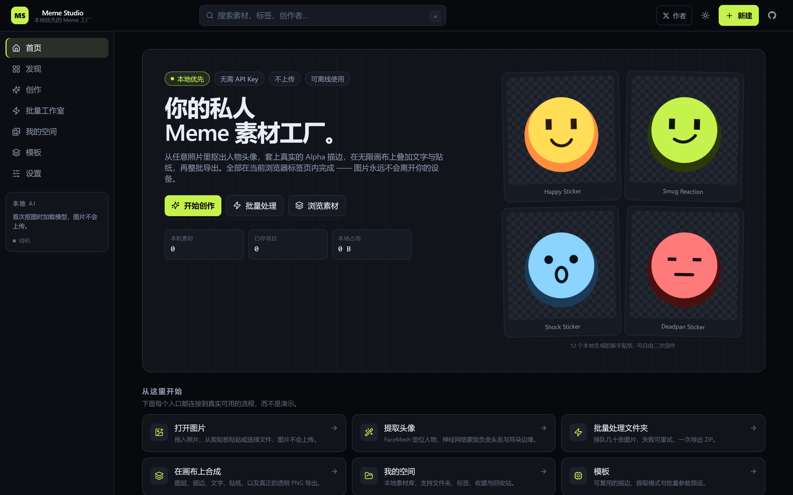 | 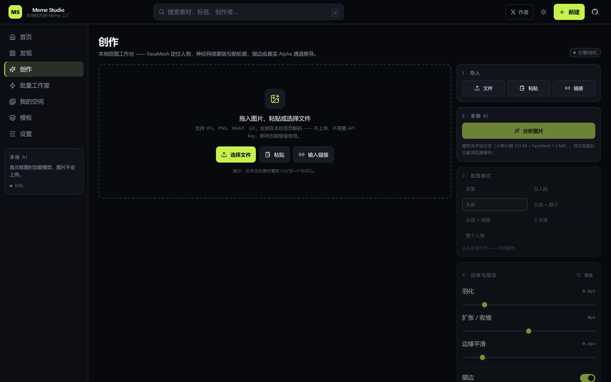 |

| 发现 | 批量工作室 |
| --- | --- |
|  | 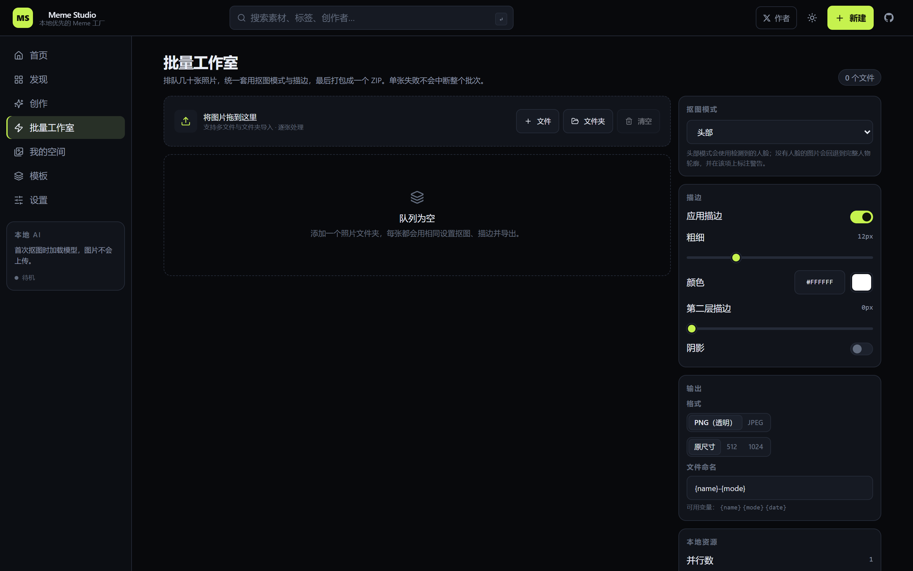 |

| 设置（语言切换） |
| --- |
| 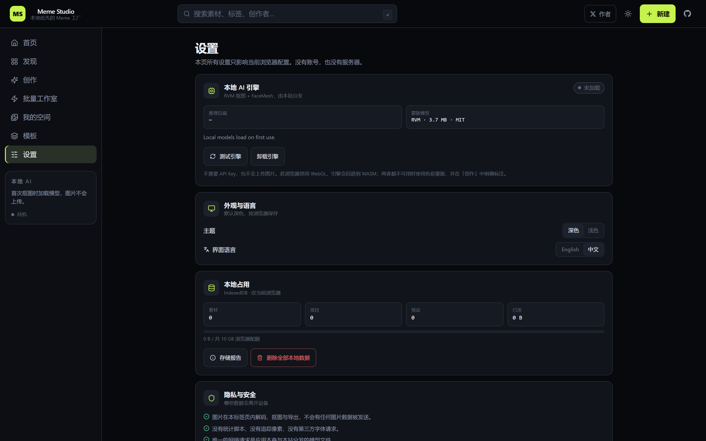 |

<p align="center">
  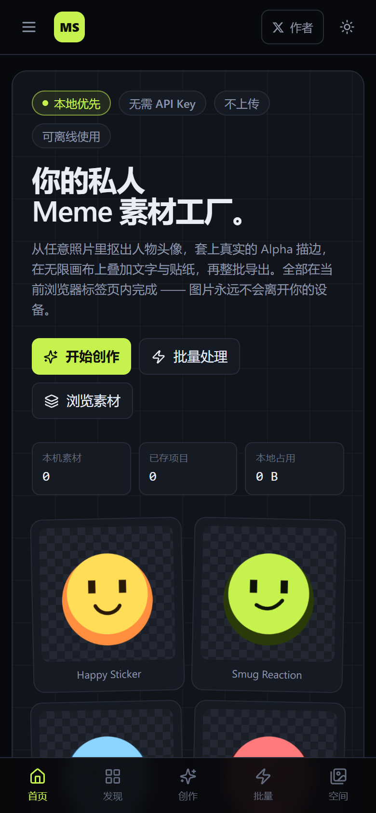
  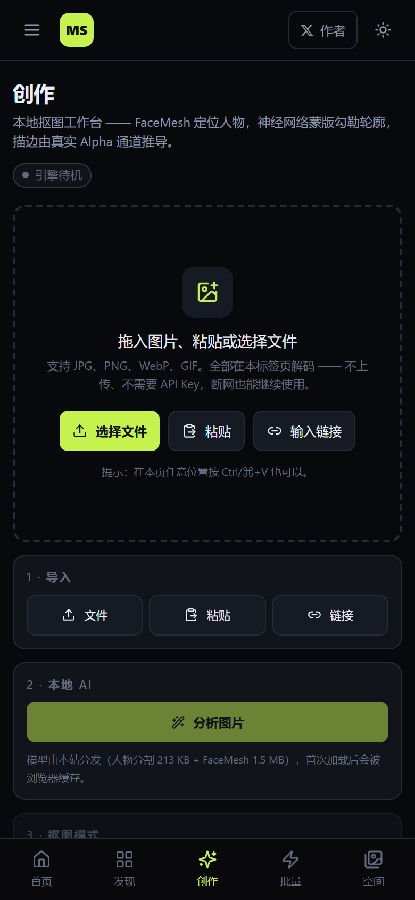
</p>

**在线体验：** <https://iiiiiiiiiiiiiKK.github.io/meme-studio/>

### 本地运行

```bash
git clone https://github.com/iiiiiiiiiiiiiKK/meme-studio.git
cd meme-studio
npm install
npm run dev
```

环境要求：**Node.js 18+** 与支持 WebGL 的浏览器（Chrome / Edge / Firefox / Safari 16+）。没有 WebGL 时自动退回
WASM；两者都不可用时使用带明确标注的色彩蒙版。

### 常用命令

| 命令 | 说明 |
| --- | --- |
| `npm run dev` | 启动开发服务器 |
| `npm run build` | 类型检查并产出生产构建到 `dist/` |
| `npm test` | 单元测试（44 个） |
| `npm run e2e` | 端到端测试（23 个：桌面 Chromium + 移动端 WebKit） |
| `npm run screenshots` | 重新生成 README 截图 |

### 环境变量

**没有。** 本项目没有后端、没有数据库服务、没有第三方服务，因此不需要任何配置，也不可能泄漏密钥。

### 部署

纯静态应用：无服务端、无环境变量、无数据库。`npm run build` 后把 `dist/` 交给任意静态托管即可。
本项目使用 GitHub Pages，线上地址：**<https://iiiiiiiiiiiiiKK.github.io/meme-studio/>**

### 隐私与安全

- **图片永远不会离开你的设备**：没有上传接口、没有 API Key、没有第三方脚本。
- 唯一的网络请求是本站点的应用包与模型文件；没有统计分析、没有追踪像素、没有第三方字体。
- “From URL” 导入由浏览器直接抓取，该站点会看到你的 IP。
- 本地数据保存在当前浏览器的 IndexedDB 中，**当前版本没有云端备份**。

### 已知限制

- **Discover 是随包发布的新手素材包**，并非带账号与发布的多用户社区；真实社区后端在路线图中，但本版本未包含。
- **头部提取质量取决于原图**：强逆光、帽子、运动模糊或人脸小于约 40 px 时效果下降，Mask 标签页可手动修补。
- **强烈建议使用 WebGL**，否则退回 WASM，处理大图明显变慢。
- **暂无云同步**，也**暂无多语言界面**。

### 许可证

[MIT](LICENSE) © Meme Studio contributors · 作者 [@0xkillcoin](https://x.com/0xkillcoin)
